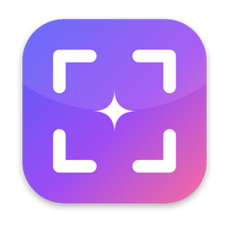
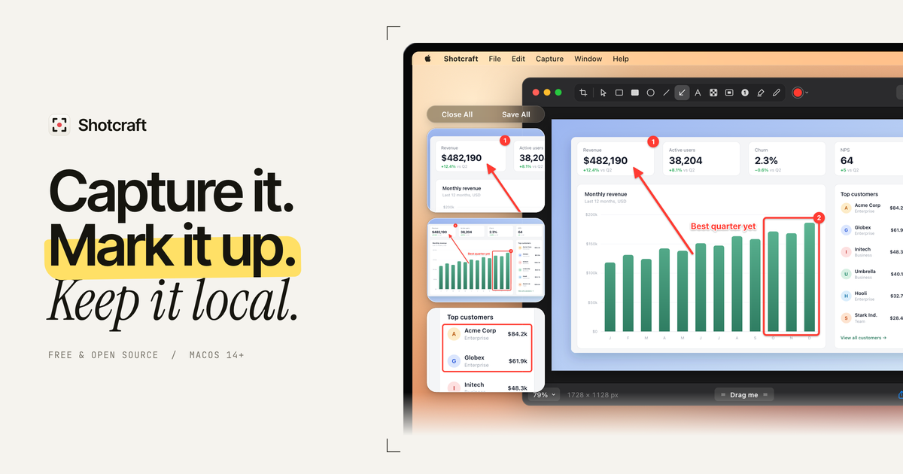

<p align="center">
  
</p>

<h1 align="center">Shotcraft</h1>

<p align="center">
  <b>Screenshots and screen recordings for macOS — crafted beautifully, kept private.</b><br>
  Capture, annotate, record, recognize text and share from a tiny app in your menu bar.<br>
  Free, open source and 100% local: nothing leaves your Mac unless you upload it.
</p>

<p align="center">
  <a href="https://udsy19.github.io/CleanShotX/"><b>Website</b></a> ·
  <a href="https://github.com/udsy19/CleanShotX/releases/latest/download/Shotcraft.dmg"><b>Download</b></a> ·
  <a href="CHANGELOG.md">Changelog</a> ·
  <a href="PRIVACY.md">Privacy</a> ·
  <a href="docs/ROADMAP.md">Roadmap</a>
</p>

<p align="center">
  <a href="https://github.com/udsy19/CleanShotX/releases/latest"></a>
  
  
  <a href="https://github.com/udsy19/CleanShotX/actions/workflows/ci.yml"></a>
  <a href="LICENSE"></a>
</p>

<p align="center">
  
</p>

---

## Install

**One line** — downloads the latest release, installs it into Applications and opens it:

```bash
curl -fsSL https://udsy19.github.io/CleanShotX/install.sh | bash
```

**Or download the [DMG](https://github.com/udsy19/CleanShotX/releases/latest/download/Shotcraft.dmg)**, drag Shotcraft to
Applications and open it. Shotcraft isn't notarized by Apple, so the first launch of a browser-downloaded copy needs
**System Settings → Privacy & Security → Open Anyway** (only once). The one-line installer doesn't need this step.

Requires macOS 14 Sonoma or later, Apple silicon or Intel. Run the same command to update; add
`-s -- --uninstall` after `bash` to remove it.

## Quick start

1. Open Shotcraft — it lives in your menu bar, and a short welcome guide sets up permissions and shortcuts.
2. Press <kbd>⌥</kbd><kbd>⇧</kbd><kbd>4</kbd> and drag over anything (or pick macOS's <kbd>⇧</kbd><kbd>⌘</kbd><kbd>4</kbd> during setup).
3. The capture appears in the Quick Access overlay: drag it into any app, copy, save, annotate, pin or upload.
4. <kbd>⌥</kbd><kbd>⇧</kbd><kbd>5</kbd> opens **All-In-One** for every other mode: window, fullscreen, scrolling, text, recording.

## Why Shotcraft?

- **One flow from capture to share.** Every screenshot lands in a floating thumbnail you can drag, copy, annotate or pin — no Save dialogs.
- **An editor worth using.** Arrows, text, counters, blur, spotlight and a background tool that turns any screenshot into a share-ready image.
- **Recordings that look produced.** Video or GIF with mic, system audio, camera and click highlights — or Studio Mode with automatic zoom and a smooth cursor.
- **Private by design.** No account, no analytics, no servers. OCR, stitching and encoding run on-device.
- **Native and tiny.** Swift and AppKit, ~8 MB, no Electron, no dependencies.

<details>
<summary><b>All features</b></summary>

### Capture
- Area, previous area, fullscreen, window and self-timer captures — plus **All-In-One**, a single overlay for every mode
- Crosshair and magnifier, window snapping, edge snapping, ⇧ to constrain, ⌥ to resize from centre, Space to move, arrow keys to nudge
- Freeze the screen while selecting; captures span multiple displays
- Window screenshots with shadow on transparent, wallpaper or colour backgrounds
- Hide desktop icons (on demand or while capturing), global colour picker

### Quick Access overlay
- Floating thumbnails with Copy, Save, Annotate, Pin, Upload and Quick Look
- Drag & drop into any app, swipe to dismiss, auto-close, Save All / Close All, restore recently closed

### Annotate
- Crop & resize, rectangle, filled rectangle, ellipse, line, arrow (5 styles), text (several styles), pen, highlighter
- Pixelate / blur / redact, spotlight, numbered counters, image layers
- Background tool: gradients, wallpapers, padding, corner radius, shadow, alignment, aspect ratio, presets
- Unlimited undo, snapping guides, auto-expanding canvas, editable `.shotcraft` documents

### Recording
- Video (H.264/HEVC) or GIF, 30/60 fps, Retina or 1×
- Microphone and system audio on separate tracks, camera bubble, click highlights, keystrokes, dim screen, countdown
- Pause, restart, discard; menu-bar timer
- Video editor: trim, remove audio, quality presets with size estimate, convert to GIF

### Studio Mode
- Records cursor movement, clicks and keystrokes alongside the screen
- Timeline editor with automatic zoom on clicks, manual zoom segments, cuts and splits
- Smooth custom cursor, backgrounds, padding, rounded corners, shadow, camera and keystroke overlays
- Export to MP4 or GIF at original, 4K, 1080p or 720p

### More
- **Capture Text** — on-device OCR with language detection, line-break control and QR codes
- **Scrolling capture** — manual or auto-scroll, vertical or horizontal, pixel-exact stitching
- **Pin to screen** — always-on-top, resizable, adjustable opacity, click-through lock
- **Capture History** — filters for screenshots, videos and GIFs; restore anything
- **Upload** — your own S3-compatible bucket, HTTP endpoint or synced folder; link copied instantly
- **Automation** — global shortcut for every action and a `shotcraft://` URL scheme
- **Extensions** — "Annotate" and "Pin to the Screen" in the share menu; Quick Look previews for documents

</details>

<details>
<summary><b>Keyboard shortcuts</b></summary>

Every shortcut can be changed in **Settings → Shortcuts**.

| Shortcut | Action |
|---|---|
| <kbd>⌥⇧4</kbd> | Capture Area |
| <kbd>⌥⇧3</kbd> | Capture Fullscreen |
| <kbd>⌥⇧5</kbd> | All-In-One |
| <kbd>⌥⇧2</kbd> | Capture Text |
| <kbd>⌥⇧6</kbd> | Record Screen (press again to stop) |
| <kbd>⌥⇧7</kbd> | Capture Previous Area |
| <kbd>⌥⇧8</kbd> | Scrolling Capture |
| <kbd>⌥⇧H</kbd> | Capture History |

**While selecting:** <kbd>Space</kbd>/<kbd>W</kbd> window mode · <kbd>F</kbd> fullscreen · <kbd>⇧</kbd> constrain ·
<kbd>⌥</kbd> from centre · arrow keys nudge · <kbd>↩</kbd> confirm · <kbd>Esc</kbd> cancel.

**In Annotate:** <kbd>V</kbd> move · <kbd>R</kbd> rectangle · <kbd>E</kbd> ellipse · <kbd>L</kbd> line · <kbd>A</kbd> arrow ·
<kbd>T</kbd> text · <kbd>P</kbd> pixelate · <kbd>H</kbd> spotlight · <kbd>C</kbd> counter · <kbd>D</kbd> pen ·
<kbd>M</kbd> highlighter · <kbd>K</kbd> crop · <kbd>B</kbd> background · <kbd>⌘Z</kbd> undo · <kbd>⌘C</kbd> copy · <kbd>⌘S</kbd> done.

</details>

<details>
<summary><b>URL scheme</b></summary>

Automate Shotcraft from Raycast, Alfred, Shortcuts or Terminal (`open "shotcraft://…"`). Commands that read the
screen ask for permission on first use (**Settings → Advanced → Allow URL scheme API**).

| Command | Parameters |
|---|---|
| `capture-area`, `capture-fullscreen`, `capture-window`, `capture-previous-area`, `self-timer`, `all-in-one` | `x`, `y`, `width`, `height`, `display`, `action=copy\|save\|annotate\|upload\|pin` |
| `capture-text` | `linebreaks=false` |
| `scrolling-capture`, `record-screen`, `record-gif`, `record-studio`, `stop-recording` | area params |
| `open-annotate`, `pin`, `add-quick-access-overlay` | `filepath` |
| `open-from-clipboard`, `open-history`, `restore-recently-closed`, `pick-color` | — |
| `toggle-desktop-icons`, `hide-desktop-icons`, `show-desktop-icons` | — |
| `open-settings` | `tab=general\|shortcuts\|recording\|…` |

Example: `open "shotcraft://capture-area?action=copy"`

</details>

## Privacy & permissions

Shotcraft has no accounts, analytics or servers — see [PRIVACY.md](PRIVACY.md). It asks for:

| Permission | Used for |
|---|---|
| Screen & System Audio Recording | Screenshots and recordings (required) |
| Accessibility | Keystroke overlay and auto-scroll (optional) |
| Microphone / Camera | Only when you enable them for a recording |

## Build from source

Only the Command Line Tools are needed (`xcode-select --install`) — no Xcode, no dependencies.

```bash
git clone https://github.com/udsy19/CleanShotX.git && cd CleanShotX
./scripts/signing-setup.sh        # once: local signing identity so permissions survive rebuilds
./scripts/build-app.sh            # → build/Shotcraft.app   (--debug for a faster build)
open build/Shotcraft.app
swift run ShotcraftSelfTest       # logic tests
./scripts/e2e.sh                  # end-to-end tests against the running app
./scripts/make-dmg.sh             # universal DMG in dist/
```

See [ARCHITECTURE.md](docs/ARCHITECTURE.md) for how the modules fit together and [TESTING.md](docs/TESTING.md) for
the test suites.

## Contributing

Issues and pull requests are welcome — read [CONTRIBUTING.md](CONTRIBUTING.md) to get started, and check the
[roadmap](docs/ROADMAP.md) for ideas. Please report security issues privately as described in [SECURITY.md](SECURITY.md).

## License

[MIT](LICENSE) © Udaya Vijay Anand.

Shotcraft is an independent project inspired by CleanShot X's workflow. It is not affiliated with or endorsed by
CleanShot X or MTW and contains none of its code or assets.
